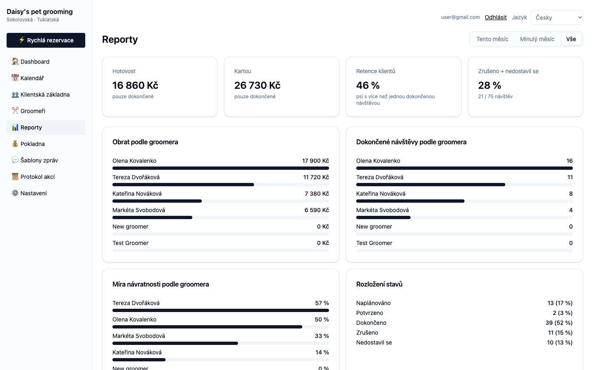
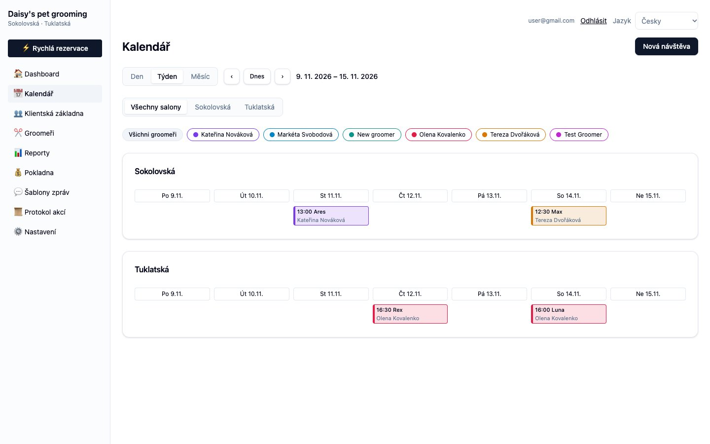
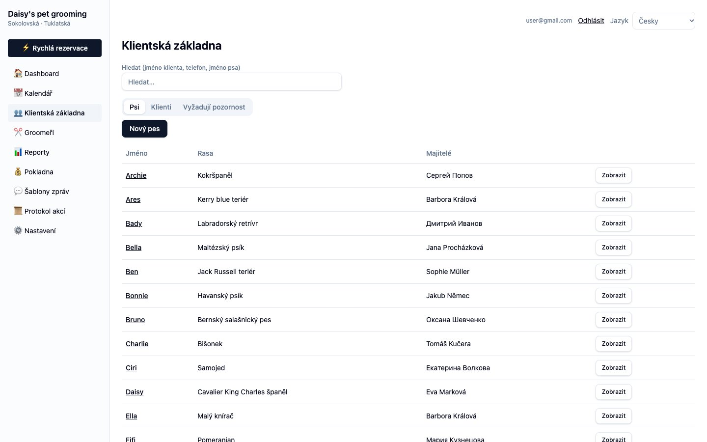
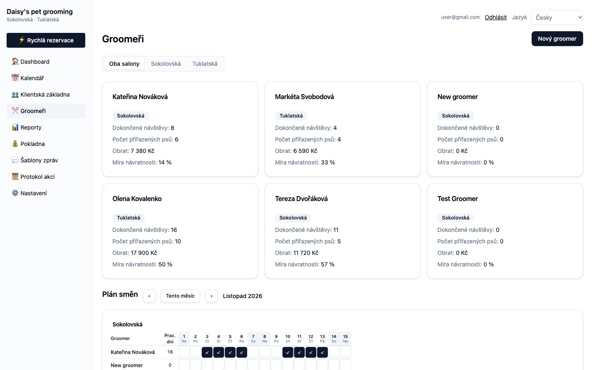

# Groom Buddy CRM

[](https://github.com/romanrudakevych/groom-buddy/actions/workflows/deploy-pages.yml)

A CRM for a dog-grooming business with two salons. It covers clients and their
dogs, visits on a shared calendar, groomers and their shifts, a cash desk with
daily closing, reports, reactivation of lapsed clients, message templates and an
audit log. The interface is in **Czech** (default) and **Russian**.

It is a single-page React app on top of Supabase: Postgres with row-level
security, Auth, private Storage for dog photos, and one Edge Function for team
administration. There is no other backend of its own.

**Live demo:** https://romanrudakevych.github.io/groom-buddy/. The sign-in form
is prefilled with the owner account, and the database is filled with demo data (see
[Demo data](#demo-data)).



## Features

- **Dashboard** (`/`) — today's and tomorrow's visits, with a "confirmed X/Y"
  counter for tomorrow, a confirm checkbox per visit, SMS / WhatsApp reminder
  templates and a call button. A per-salon cash block shows cash from visits,
  deposits and outflows, expected vs. counted cash, and lets you close the day.
- **Calendar** (`/kalendar`) — day, week and month views with a salon filter and
  per-groomer chips. The day view has one column per groomer; clicking an empty
  hour starts a new visit, clicking a visit opens a read-only quick view that
  hands off to the edit dialog.
- **Quick booking** — find a dog (or create dog and owner inline), and the dialog
  picks the dog's pinned groomer and salon, shows each groomer's nearest free
  slot, and defaults the length to "as last time".
- **Slot picker** — a strip of days with free-slot counts or "day off", slots
  grouped into morning / afternoon / evening, and the best slot starred. Slot
  and duration math lives in `src/lib/booking.ts`.
- **Clients** (`/klienti`) — tabs for dogs, owners and reactivation; search,
  salon filter, sorting and a last-visit filter. Client cards (`/klienti/:id`)
  show contacts with WhatsApp / call / SMS / email buttons, family contacts,
  dogs, upcoming bookings and visit history.
- **Dog profile** (`/psi/:id`) — photo, health and coat status, toothbrush number,
  grooming instructions, haircut notes, main owner, last grooming, upcoming
  bookings and visit history with actual duration and behavior.
- **Reactivation** — dogs with no visit for 60 / 90 / 120+ days and no upcoming
  booking. Log a contact with its result, reason for absence and a "remind on"
  date.
- **Groomers** (`/groomeri`) — cards with this month's visits, revenue, return
  rate and assigned dogs, plus a monthly shift grid per salon. Groomer details
  add the no-show rate, upcoming visits and visit history.
- **Cash desk** (`/kassa`) — today's cash and card takings, the drawer balance,
  manual deposits / expenses / collections, and a searchable cash journal.
- **Reports** (`/reporty`) — cash and card revenue, client retention and
  cancelled / no-show rate for a chosen period, plus per-groomer revenue, visits
  and return rate.
- **Message templates** (`/sablony`) — reminder and follow-up texts per language
  and type, with copy-to-clipboard.
- **Audit log** (`/logs`) — every visit and cash change, written by database
  triggers, filterable by action, date and salon.
- **Settings** (`/nastaveni`) — invite staff by email or share a one-time access
  link, assign roles (owner / admin / groomer), link a user to a groomer, and set
  permissions per role with per-user overrides.
- **Locked visits** — a completed visit can no longer be changed except for its
  notes; this is enforced by a database trigger as well as in the UI.

## Screenshots

**Calendar** — week view across both salons, colored by groomer:



**Clients** — the dog list with owners, plus tabs for owners and reactivation:



**Groomers** — monthly figures per groomer and the shift plan:



## Tech stack

| Purpose        | Choice                                                         |
| -------------- | -------------------------------------------------------------- |
| UI             | React 19, TypeScript (strict)                                  |
| Build / dev    | Vite 8                                                         |
| Routing        | React Router 7 (`createBrowserRouter`, Czech URL slugs)        |
| Server state   | TanStack Query 5 — one `["crm"]` query plus mutations          |
| Styling        | Tailwind CSS 4 + shadcn/ui (Radix primitives)                  |
| Forms          | react-hook-form + zod                                          |
| Charts / dates | Recharts, date-fns                                             |
| Backend        | Supabase: Postgres + RLS, Auth, Storage, Edge Functions (Deno) |
| i18n           | Hand-rolled (`src/lib/i18n.tsx`), Czech and Russian            |
| Linting        | ESLint 9 with Prettier as a rule                               |
| Tests          | Vitest                                                         |
| Hosting        | GitHub Pages (also works on Netlify, Cloudflare Pages, Vercel) |

## Getting started

Requires Node.js 20.19+ (Vite 8); CI builds on Node 24.

```bash
npm install
cp .env.example .env   # fill in the Supabase URL and publishable key
npm run dev            # http://localhost:5173
```

The app is invite-only: sign in with an account that exists in Supabase Auth.
The first user created becomes the owner and can invite everyone else from
Settings.

To prefill the sign-in form locally, put the login in `.env.development.local`
(gitignored, loaded only by `vite dev`):

```bash
VITE_LOGIN_EMAIL=you@example.com
VITE_LOGIN_PASSWORD=...
```

### Environment variables

| Variable                         | Used by        | Purpose                                                   |
| -------------------------------- | -------------- | --------------------------------------------------------- |
| `VITE_SUPABASE_URL`              | app            | Supabase project URL                                      |
| `VITE_SUPABASE_PUBLISHABLE_KEY`  | app            | Public (publishable) API key                              |
| `VITE_PUBLIC_URL`                | app            | Address used in invite / password-reset links             |
| `VITE_LOGIN_EMAIL` / `_PASSWORD` | app            | Optional sign-in prefill                                  |
| `VITE_BASE`                      | build          | Base path; `/groom-buddy/` on GitHub Pages, `/` otherwise |
| `SUPABASE_SECRET_KEY`            | `db:seed` only | Bypasses RLS — never prefix with `VITE_`                  |
| `SUPABASE_DB_URL`                | CLI only       | Postgres connection string                                |

### Scripts

| Script                     | Description                                                      |
| -------------------------- | ---------------------------------------------------------------- |
| `npm run dev`              | Vite dev server with HMR                                         |
| `npm run build`            | Production build to `dist/`                                      |
| `npm run preview`          | Serve the production build locally                               |
| `npm run lint`             | ESLint (Prettier runs as a rule)                                 |
| `npm run format`           | Prettier `--write`                                               |
| `npx tsc --noEmit`         | Type-check (no script for it)                                    |
| `npx vitest run`           | Run the test suite                                               |
| `npm run db:new -- <name>` | Create `supabase/migrations/<timestamp>_<name>.sql`              |
| `npm run db:push`          | Apply pending migrations to the linked Supabase project          |
| `npm run db:seed`          | Fill the linked project with demo data (`-- --clean` removes it) |
| `npm run functions:deploy` | Deploy the `team-admin` Edge Function                            |

## Supabase

- **Schema** — exists only as SQL migrations in `supabase/migrations/`. Never edit
  an applied migration; add a new one with `npm run db:new`, then `npm run
db:push`. Regenerate `src/integrations/supabase/types.ts` when the schema
  changes. Link the CLI once with `npx supabase link --project-ref <ref>`.
- **Auth** — email + password. In **Authentication → URL Configuration**, set the
  Site URL to the deployed address and add it (with `/**`) to the redirect URLs,
  next to `http://localhost:5173/**`, or invite and reset links are rejected.
- **Storage** — private bucket `dog-photos`. The original photo is uploaded there
  and opened through a short-lived signed URL; a resized copy is kept on the dog
  row for thumbnails.
- **Edge Function `team-admin`** — one function with three owner-only actions:
  `invite`, `access-link` and `delete`. It runs on Supabase, not on the static
  host, and checks the caller itself (deployed with `--no-verify-jwt`). Redeploy
  it with `npm run functions:deploy` only when `supabase/functions/team-admin`
  changes.

### Demo data

`scripts/seed-demo.mjs` fills the linked project with a realistic data set:
4 groomers with shifts, 24 clients (Czech, Russian, Ukrainian and English
speakers), 32 dogs, ~75 visits from ten weeks ago to three weeks ahead, cash
operations and reactivation contacts.

```bash
npm run db:seed              # refuses if demo data already exists
npm run db:seed -- --clean   # removes only the demo rows
```

Demo rows are recognisable (`@example.com` client emails, fixed groomer names,
`(demo)` cash notes), so `--clean` leaves real data alone. Audit-log entries
written by the triggers during seeding are kept.

## Deployment (GitHub Pages)

The app is hosted at **https://romanrudakevych.github.io/groom-buddy/** and is
deployed by `.github/workflows/deploy-pages.yml` on every push to `master` (or
manually from the Actions tab).

One-time setup:

- **Settings → Pages → Source: "GitHub Actions"**.
- **Settings → Secrets and variables → Actions → Variables**:
  `VITE_SUPABASE_URL`, `VITE_SUPABASE_PUBLISHABLE_KEY`, `VITE_PUBLIC_URL`, and
  optionally `VITE_LOGIN_EMAIL` / `VITE_LOGIN_PASSWORD`. Only public values
  belong here — never the secret key or the database URL.
- The Supabase redirect URLs described above.

How it works:

- The workflow builds with `VITE_BASE=/groom-buddy/`; `vite.config.ts` uses it as
  `base`, and the router uses `import.meta.env.BASE_URL` as its `basename`.
- Pages has no rewrites, so the workflow copies `index.html` to `404.html` and
  deep links such as `/groom-buddy/kalendar` still load the app. `BrowserRouter`
  is kept (not a hash router) because Supabase puts invite and recovery tokens in
  the URL hash.
- On other hosts, `public/_redirects` (Netlify / Cloudflare Pages) and
  `vercel.json` (Vercel) provide the SPA fallback, with the base left at `/`.

> **Note:** values passed to the build as `VITE_*` end up in the public bundle.
> With a login prefilled on the live site, anyone who opens it signs in with
> that account's role.

## Architecture

### Data layer

`src/lib/crm.ts` holds one TanStack query, `["crm"]`, whose `fetchAll` loads
every table the user may see and maps the rows to a denormalized `CrmData`
(`client.dogIds`, `dog.clientIds`, `appointment.serviceIds`, …). Pages read it
with `useCrm()`. Every write is an async function in the same file
(`saveClient`, `saveDog`, `saveAppointment`, `saveCashOp`, …) run through
`useCrmMutation(fn)`, which invalidates `["crm"]` on success. Pricing
(`sizePrice`, `servicePriceForDog`), date helpers, cash maths (`dayCash`,
`drawerBalance`) and `inactiveDogs` live there too.

### Stored values are Czech literals

Statuses, sizes, coat types, cash-operation types and similar values are stored
as Czech strings (`"Naplánováno"`, `"Dokončeno"`, `"Vklad"`, …), defined as
`as const` arrays in `crm.ts` and guarded by `CHECK` constraints. They are never
changed — only translated for display through `src/lib/i18n.tsx`.

### Roles and permissions

Three roles — `owner`, `admin`, `groomer` — live in `user_roles`. Effective
permissions are the `role_permissions` defaults with per-user `user_permissions`
overrides on top; the owner has everything. `src/lib/access.ts` adds fixed admin
restrictions (cash desk, reports, logs) that override even a stale grant. The
client-side checks only hide UI: **row-level security in the migrations is the
real access control** (`has_role`, `is_staff`, `my_groomer_id`,
`has_permission`).

### Domain rules

- Each dog has exactly one main owner (`dogs.owner_id`); extra family contacts
  are JSON on the client (`clients.additional_contacts`). `client_dogs` is
  deprecated.
- Creating and editing visits always goes through `AppointmentDialog`, so there
  is a single save path; the calendar quick view is read-only.
- A completed visit is locked by triggers on `appointments` and
  `appointment_services`; only its notes can change.

## Tests

```bash
npx vitest run                                   # all
npx vitest run src/lib/__tests__/booking.test.ts # one file
```

26 tests in `src/lib/__tests__/` cover the pure domain logic: booking slots and
durations, size-based pricing, daily cash and drawer balance, inactive-dog
detection for reactivation, admin access restrictions, groomer-finance
visibility and assigned-dog counts.

## Project structure

```
.github/workflows/deploy-pages.yml  # build + deploy to GitHub Pages on push to master
public/                             # favicon, robots.txt, _redirects
scripts/seed-demo.mjs               # demo data seeder (npm run db:seed)
supabase/
├── config.toml
├── migrations/                     # the schema, RLS policies, triggers and seed rows
└── functions/team-admin/           # owner-only invite / access link / delete (Deno)
src/
├── main.tsx                        # entry point
├── app/
│   ├── router.tsx                  # routes with Czech slugs, page titles in handle
│   └── RootLayout.tsx              # providers, auth gate, navigation, page access
├── pages/                          # Dashboard, Calendar, Clients, ClientDetail, DogDetail,
│                                   # Groomers, GroomerDetail, Cashdesk, Reports, Templates,
│                                   # AuditLogs, Settings
├── components/
│   ├── crm/                        # dialogs, DialogProvider, QuickBooking, SlotPicker,
│   │                               # Reactivation, SignInScreen, shared CRM UI
│   └── ui/                         # generated shadcn/ui components
├── lib/
│   ├── crm.ts                      # data layer, domain types and helpers
│   ├── booking.ts                  # slot and duration maths
│   ├── auth.tsx                    # AuthProvider, roles, permissions, canOpenPath
│   ├── access.ts                   # fixed admin restrictions
│   ├── groomer-finances.ts         # who may see groomer finance figures
│   ├── i18n.tsx                    # Czech / Russian dictionaries and value translations
│   ├── team.api.ts                 # calls to the team-admin Edge Function
│   ├── app-url.ts                  # base URL for auth email links
│   └── __tests__/                  # Vitest suites
└── integrations/supabase/          # client and generated database types
```

### Routes

| Path                   | Page              |
| ---------------------- | ----------------- |
| `/`                    | Dashboard         |
| `/kalendar`            | Calendar          |
| `/klienti`             | Clients           |
| `/klienti/:clientId`   | Client details    |
| `/psi/:dogId`          | Dog profile       |
| `/groomeri`            | Groomers          |
| `/groomeri/:groomerId` | Groomer details   |
| `/kassa`               | Cash desk         |
| `/reporty`             | Reports           |
| `/sablony`             | Message templates |
| `/logs`                | Audit log         |
| `/nastaveni`           | Settings          |
| `*`                    | Not found         |

## Built with Claude Code

This project — application code, database migrations, deployment and this
README — was created with [Claude Code](https://claude.com/claude-code).

## License

No license file is included; all rights reserved by the author unless stated
otherwise.
